# 🛡️ DepositGuard

<div align="center">


### **Your deposit deserves proof, not promises.**

*A startup-grade proptech–fintech platform creating an immutable, shared digital record for rental condition baselines, photographic evidence comparison, and decimal-safe deposit settlements.*

[](https://nextjs.org/)
[](https://react.dev/)
[](https://www.typescriptlang.org/)
[](https://tailwindcss.com/)
[](https://threejs.org/)
[](https://motion.dev/)
[](https://github.com/pandeyaayush019ap-dev/depositguard)
[](LICENSE)

[**Explore Live Demo**](http://localhost:3000) • [**Architecture Docs**](#-system-architecture) • [**Core Workflow**](#-the-core-workflow) • [**Settlement Formula**](#-decimal-safe-settlement-engine) • [**Security & Trust**](#-trust-security--legal-boundaries)

</div>

---

## 📖 The Problem We Solve

Tenants repeatedly face anxiety when moving out of rented properties. Scratches are disputed, inflated contractor invoices are presented without evidence, and security deposit refunds are arbitrarily withheld for weeks or months.

Landlords face the reverse problem: unverified claims of pre-existing dampness, difficulty proving fresh structural damage caused by past occupants, and contentious arguments during turnover walkthroughs.

**DepositGuard replaces informal text messages and guesswork with a single, verifiable digital ledger.** Both parties document baseline condition at move-in, inspect delta differences at move-out, and calculate acknowledged deduction balances with mutual electronic signoff.

---

## ✨ Key Features & Capabilities

```
┌────────────────────────────────────────────────────────────────────────┐
│                        DEPOSITGUARD ECOSYSTEM                         │
├────────────────────────────────────────────────────────────────────────┤
│  🏢 3D Architectural Scene   │ Interactive isometric WebGL apartment   │
│  📷 Move-In & Exit Audits    │ Room-by-room photo logs & meter records │
│  ↔️ Evidence Comparison     │ Touch-interactive split-screen slider   │
│  ⚖️ Transparent Ledger       │ Decimal-safe refund balance calculator  │
│  📄 Certified PDF Export     │ Official audit-ready condition report   │
│  👥 Dual Stakeholder Personas│ Instant 1-click Tenant/Landlord switch  │
└────────────────────────────────────────────────────────────────────────┘
```

### 1. 🏢 3D WebGL Architectural Visualizer
- Interactive Three.js isometric contemporary apartment model.
- Dynamic room condition nodes (*Living Room, Kitchen, Master Bed, Bathroom, Balcony*).
- Directional soft shadowing, ambient emerald illumination (`#16C784`), and orbital camera controls.
- Full support for `prefers-reduced-motion`.

### 2. ↔️ Interactive Evidence Delta Comparison
- High-performance before-and-after photo split slider.
- Touch-, mouse-, and keyboard-accessible divider allowing direct comparison between baseline and exit photos.
- Direct integration allowing users to flag discrepancies and propose deductions linked to visual evidence.

### 3. ⚖️ Decimal-Safe Settlement Ledger
- Mathematical guarantee: **Disputed deductions are never subtracted from the refund balance** until mutually resolved.
- Real-time balance updates: $\text{Refundable Balance} = \text{Original Deposit} - \text{Agreed Deductions}$.
- Prevents negative balances and IEEE-754 floating-point inaccuracies.

### 4. 📄 Certified Condition & Settlement PDF Report
- Formal, printable certificate with reference identifier (e.g., `DG-CERT-SKYL14B-XXX`).
- Complete breakdown of room conditions, baseline and exit photos, meter readings (kWh, kL, gas units).
- Dual electronic signature acknowledgment blocks suitable for conciliation or dispute tribunals.

### 5. 👥 Role Switcher & Persona Testing
- Instant 1-click persona switching:
  - **Priya Sharma (Tenant)**: Focuses on deposit recovery and wear-and-tear protection.
  - **Arjun Mehta (Landlord)**: Focuses on turnover documentation and legitimate repair invoices.
  - **Vikram Rao (Property Manager)**: Portfolio oversight and neutral record mediation.

---

## 🔄 The Core Workflow

```mermaid
flowchart LR
    A["1. Create Record"] --> B["2. Move-In Baseline"]
    B --> C["3. Mutual Signoff"]
    C --> D["4. Move-Out Walkthrough"]
    D --> E["5. Evidence Delta Comparison"]
    E --> F["6. Settlement Ledger"]
    F --> G["7. Certified PDF Clearance"]

    style A fill:#0C1B2B,stroke:#16C784,stroke-width:2px,color:#fff
    style B fill:#0C1B2B,stroke:#38BDF8,stroke-width:2px,color:#fff
    style C fill:#0C1B2B,stroke:#16C784,stroke-width:2px,color:#fff
    style D fill:#0C1B2B,stroke:#F5B942,stroke-width:2px,color:#fff
    style E fill:#0C1B2B,stroke:#38BDF8,stroke-width:2px,color:#fff
    style F fill:#0C1B2B,stroke:#16C784,stroke-width:2px,color:#fff
    style G fill:#0C1B2B,stroke:#9BF5CC,stroke-width:2px,color:#fff
```



1. **Establish Rental Record**: Landlord or tenant registers property address, deposit amount (₹), lease dates, and agreed wear-and-tear clauses.
2. **Move-In Walkthrough**: Capture room-by-room baseline photographs, pre-existing nail holes, appliance functionality, and utility meters.
3. **Dual Electronic Seal**: Both parties digitally acknowledge the baseline state within the agreed grace period (e.g., 7 days).
4. **Move-Out Walkthrough**: Repeat the inspection at lease termination from identical camera angles.
5. **Split-Screen Comparison**: Inspect observable changes side-by-side to separate normal ageing from confirmed tenancy damage.
6. **Settlement Negotiation**: Propose, approve, or dispute individual repair line items with attached invoices.
7. **Mutual Clearance**: Calculate final refund balance and export the signed certified condition report.

---

## 🧮 Decimal-Safe Settlement Engine

DepositGuard enforces strict financial logic in `src/lib/settlementCalculator.ts`:

$$\text{Refundable Balance} = \max\left(0, \text{Original Deposit} - \sum \text{Agreed Deductions}\right)$$

### Key Invariants:
1. **Disputed Isolation**: Disputed amounts are tracked in a dedicated ledger but **never** deducted from the tenant's refundable balance.
2. **Precision Safety**: All values are rounded via `roundToTwoDecimals(num)` to eliminate JavaScript floating-point artifacts (e.g. `0.1 + 0.2 = 0.30000000000000004`).
3. **Waived Deductions**: Waived charges are archived and excluded from all calculations.
4. **Non-Negative Bounds**: Balances are strictly clamped to $\ge 0$.

```typescript
// Sample Settlement Calculation
const deposit = 120000; // ₹1,20,000
const deductions = [
  { title: "Chimney Degreasing", proposed: 2500, agreed: 2500, status: "agreed" },
  { title: "Shower Hose Coupler", proposed: 1500, agreed: 1500, status: "agreed" },
  { title: "Full Wall Repaint",  proposed: 4500, agreed: 0,    status: "disputed" }
];

// Result:
// Total Agreed:    ₹4,000
// Disputed Amount: ₹4,500
// Refund Balance:  ₹1,16,000 (Disputed ₹4,500 is NOT deducted)
```

---

## 🔒 Trust, Security & Legal Boundaries

DepositGuard takes compliance and transparency seriously:

- **Documentation, Not Escrow**: DepositGuard is an evidence management software platform. It is **not** an escrow bank, regulated deposit holder, or payment custodian.
- **Direct Bank Transfers**: Actual security deposit refunds are disbursed directly between tenant and landlord via agreed banking channels (NEFT, RTGS, UPI).
- **No Binding Legal Adjudication**: Our photographic tools organize evidence for human review. They do not issue legally binding determinations of fault.
- **Participant-Only Access**: Property evidence files are restricted strictly to invited tenancy participants and are never indexed by public search engines.

---

## 🛠️ Tech Stack & Architecture

| Layer | Technologies |
| :--- | :--- |
| **Framework** | Next.js 16.4.3 (App Router, Turbopack, Partial Prerendering) |
| **Language** | TypeScript 5.x (Strict typing across entities and APIs) |
| **Styling** | Tailwind CSS v4, Custom Design Tokens, CSS Glassmorphism |
| **3D Graphics** | Three.js v0.186 (Perspective Camera, Directional & Ambient Lighting, WebGL) |
| **Animation** | Motion for React (`motion/react` v14.7) |
| **Icons** | Lucide React |
| **Confetti FX** | Canvas-Confetti |
| **Testing** | Node.js Test Runner (`node:test`, `node:assert/strict`) |

---

## 🚀 Getting Started

### Prerequisites
- Node.js 20+ (Node.js 24 recommended)
- npm 10+ or pnpm

### Installation

1. **Clone the repository**:
   ```bash
   git clone https://github.com/pandeyaayush019ap-dev/depositguard.git
   cd depositguard
   ```

2. **Install dependencies**:
   ```bash
   npm install
   ```

3. **Configure Environment Variables**:
   ```bash
   cp .env.example .env.local
   ```

4. **Run Automated Tests**:
   ```bash
   npm test
   ```

5. **Start Development Server**:
   ```bash
   npm run dev
   ```
   Open [http://localhost:3000](http://localhost:3000) in your browser.

6. **Production Build**:
   ```bash
   npm run build
   npm run start
   ```

---

## 🧪 Testing Suite

Run the comprehensive test suite validating all mathematical invariants and critical user journeys:

```bash
npm test
```

### Verified Scenarios:
- `Scenario 1`: Property record creation with deposit amount and wear-and-tear defaults.
- `Scenario 2`: Multi-party dual electronic signature requirement for mutual agreement.
- `Scenario 3`: Inspection condition discrepancy detection between move-in and exit.
- `Scenario 4`: Settlement calculation isolating disputed amounts from refund balances.
- `Scenario 5`: Operational boundary validation (no false escrow or auto-withdrawal claims).
- `Scenario 6`: IEEE-754 floating point precision and non-negative clamping tests.

---

## 📁 Repository Structure

```
depositguard/
├── .github/
│   └── workflows/
│       └── ci.yml                 # Automated CI test and build workflow
├── src/
│   ├── app/
│   │   ├── page.tsx               # Marketing landing page
│   │   ├── globals.css            # Design tokens & glassmorphism
│   │   ├── layout.tsx             # Root layout with metadata
│   │   ├── auth/                  # Authentication & persona switchers
│   │   ├── app/                   # Protected portal experience
│   │   │   ├── page.tsx           # Dashboard & analytics
│   │   │   ├── onboarding/        # Guided tenancy wizard
│   │   │   ├── properties/        # Property management & directory
│   │   │   │   └── [id]/
│   │   │   │       ├── inspection/# Move-in & exit inspection checklist
│   │   │   │       ├── comparison/# Split-screen photo comparison
│   │   │   │       ├── settlement/# Settlement ledger & dispute negotiation
│   │   │   │       └── report/    # Certified PDF report generator
│   │   │   ├── settings/          # Persona switcher & demo data reset
│   │   │   └── notifications/     # Audit timeline feed
│   │   ├── terms/                 # Legal terms of service
│   │   ├── privacy/               # Data retention & privacy
│   │   └── trust/                 # Cryptographic audit specification
│   ├── components/
│   │   ├── 3d/
│   │   │   └── Apartment3DCanvas  # Interactive 3D WebGL apartment
│   │   ├── app/
│   │   │   ├── BeforeAfterSlider  # Evidence comparison split slider
│   │   │   ├── SettlementSummary  # Decimal-safe calculation card
│   │   │   └── ActivityTimeline   # Tamper-evident audit trail
│   │   ├── landing/               # High-converting modular landing sections
│   │   └── ui/
│   │       └── Modal.tsx          # Accessible native <dialog> component
│   └── lib/
│       ├── types.ts               # Core TypeScript data schemas
│       ├── settlementCalculator.ts# Financial calculation engine
│       ├── storage.ts             # Unified storage & reactivity engine
│       └── mockData.ts            # Realistic sample tenancies (Skyline Heights)
└── test/
    ├── settlement.test.mjs        # Calculation unit tests
    └── e2e-scenarios.test.mjs     # Critical journey integration tests
```

---

## 📄 License

This project is licensed under the MIT License — see the [LICENSE](LICENSE) file for details.

---

<div align="center">
  <b>DepositGuard</b> — Your deposit deserves proof, not promises.
</div>
